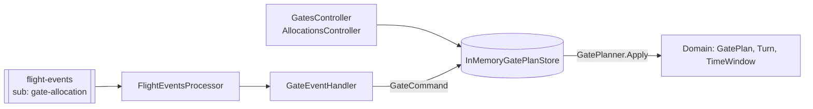

# svc-gate-allocation

> Plans which stand (gate) each departing aircraft uses and when, without double-booking a gate.

| | |
| --- | --- |
| Repo | `aeroflow-air/svc-gate-allocation` |
| Owner | AeroFlow platform (Tony Joanes) |
| Status | prototype, local only |
| Runs in | aeroflow-local AppHost resource `svc-gate-allocation`; Container Apps later (ADR-0007) |
| Last reviewed | 2026-10-12 |

Written to the [service docs standard](https://github.com/aeroflow-air/platform-handbook/blob/main/docs/standards/service-docs.md). The airport-wide picture is in the [airport overview](https://github.com/aeroflow-air/platform-handbook/blob/main/docs/architecture/airport-overview.md).

## Purpose

Owns the **gate plan**: the gates, their size and open/closed status, and every flight's allocation (an on-block to off-block window on one gate). It enforces the rules that make a plan valid: one allocation per flight, aircraft fits the gate, gate is open, a minimum turnaround between flights on a gate.

It does **not** own flights (svc-flight-status does), does not plan arrivals yet, and does not tell anyone which gate it chose (no published events, see [Known gaps](#known-gaps)).

## Design decisions

| Decision | Why | Link |
| --- | --- | --- |
| Pure domain (`GatePlanner.Apply(plan, command)` returns `Result<GatePlan>`), side effects at the edges | testable without I/O; typed errors with stable codes | [ADR-0004](https://github.com/aeroflow-air/platform-handbook/blob/main/docs/decisions/0004-functional-style-csharp.md) |
| Planner picks the smallest open free gate that fits, then lowest id | keeps big gates free for big aircraft | `Domain/GatePlanner.cs` |
| React to `flight-events` on its own subscription; never call other services | services stay decoupled; a new consumer just adds a subscription | [ADR-0013](https://github.com/aeroflow-air/platform-handbook/blob/main/docs/decisions/0013-central-event-bus.md) |
| Business rejections are completed, not retried | a retry would fail the same way; the log is the signal | `Messaging/FlightEventsProcessor.cs` |
| Messaging only starts when a `messaging` connection string exists | `dotnet run`, container and tests need no bus | `Program.cs` |
| Departures from the home airport only; every simulated turn is size C | the simulator sends no aircraft type, and arrivals are out of scope for now | `Messaging/GateEventHandler.cs` |
| OpenAPI via Swashbuckle, rendered by Scalar, Development only | [ADR-0015](https://github.com/aeroflow-air/platform-handbook/blob/main/docs/decisions/0015-api-documentation-openapi-scalar.md) | `Program.cs` |
| State in memory, seeded with a demo pier | no database until it is needed | `Storage/` |

## Architecture

- **Domain** (`src/AeroFlow.GateAllocation/Domain`): value types (`FlightNumber`, `GateId`, `TimeWindow`, `AircraftSize` C to F), `Gate`, `Turn`, `GatePlan`, and the closed command set `AllocateGate`, `ReassignGate`, `RetimeTurn`, `ReleaseGate`, `CloseGate`, `ReopenGate`.
- **Storage**: one in-memory plan updated atomically; seeded by `DemoGatePlan` with gates `7`, `9`, `21`, `R1` (C), `12` (D), `14` (E), `55A` (F). `R1` is closed, so six are usable. Minimum turnaround 15 minutes.
- **Messaging**: a hosted Service Bus processor (one message at a time, manual completion) hands each event to `GateEventHandler`, which turns it into a command.
- **API**: controllers over the same store.

## Inputs

### HTTP API

| Method | Route | Purpose | Responses |
| --- | --- | --- | --- |
| GET | `/health` | liveness | 200 |
| GET | `/api/gates/ping` | probe | 200 |
| GET | `/api/gates` | all gates with their allocations | 200 |
| GET | `/api/gates/{gate}` | one gate | 200, 400, 404 |
| POST | `/api/gates/{gate}/close` | close a gate (`reason`) | 200, 400, 404, 409 |
| POST | `/api/gates/{gate}/reopen` | reopen it | 200, 400, 404, 409 |
| GET | `/api/allocations/{flightNumber}` | a flight's allocation | 200, 400, 404 |
| POST | `/api/allocations` | allocate (omit `gate` to let the planner pick) | 201, 400, 404, 409 |
| PUT | `/api/allocations/{flightNumber}/gate` | reassign | 200, 400, 404, 409 |
| PUT | `/api/allocations/{flightNumber}/window` | retime | 200, 400, 404, 409 |
| DELETE | `/api/allocations/{flightNumber}` | release | 204, 400, 404 |

Errors are `application/problem+json` with a `code` extension: 400 for validation (`invalid_flight_number`, `invalid_gate`, `invalid_aircraft_size`, `empty_time_window`), 404 (`gate_not_found`, `allocation_not_found`), 409 for rules (`gate_conflict`, `aircraft_too_large`, `gate_closed`, `gate_has_allocations`, `already_allocated`, `no_gate_available`, ...). Reference docs: `/scalar` and `/openapi/v1.json` when `ApiDocs:Enabled` is true (Development).

### Events consumed

| Topic | Subscription | Event types handled | Effect | Ignored |
| --- | --- | --- | --- | --- |
| `flight-events` | `gate-allocation` | `Scheduled` | `AllocateGate`, planner picks; window 45 min before `scheduledDeparture` to departure, size C | flights whose `origin` is not `HomeAirport` |
| | | `Delayed` | `RetimeTurn` to `scheduledDeparture + delayMinutes` | |
| | | `Departed`, `Cancelled` | `ReleaseGate` | |
| | | | | `Boarding`, `Landed` |

Contract: `Messaging/FlightEventMessage.cs`, a **local copy** of `AeroFlow.Local.FlightEvents.FlightEvent` in aeroflow-local. JSON web casing, enum as string.

### Configuration

| Setting | Default | Meaning |
| --- | --- | --- |
| `ConnectionStrings:messaging` | unset | Service Bus; when unset the processor does not start |
| `FlightEvents:Topic` | `flight-events` | |
| `FlightEvents:Subscription` | `gate-allocation` | set by the AppHost via `FlightEvents__Subscription` |
| `FlightEvents:HomeAirport` | `LHR` | only departures from here are planned |
| `FlightEvents:GateMinutesBeforeDeparture` | 45 | on-block time before departure |
| `FlightEvents:DefaultAircraftSize` | `C` | size for simulated turns |
| `ApiDocs:Enabled` | false (true in Development) | Scalar and OpenAPI |

## Outputs

### Events published

None. The chosen gate is only visible through the API.

### Other side effects

Updates the in-memory gate plan. Logs `{Command} for {FlightNumber} after {EventType}` per applied event.

## Dependencies

| Dependency | Needed for | Behaviour when absent |
| --- | --- | --- |
| Service Bus (`messaging`), topic `flight-events`, subscription `gate-allocation` | following the simulator | API still works; no event processing |
| flight-simulator (aeroflow-local) | producing events | plan only changes through the API |
| Keycloak (`identity`) | referenced by the AppHost | not used; no auth yet |

## Failure modes

| Failure | How it shows up | Impact | What to do |
| --- | --- | --- | --- |
| All six open gates busy | warning `Scheduled for XX123 rejected: no_gate_available` | that flight gets no gate; message completed | expected under load; lower `Simulator__NewFlightProbability` or add gates |
| Release or retime for a flight it never allocated (service started mid-flight, or not allocated) | warning with `allocation_not_found` | none | expected after a restart |
| Redelivered `Scheduled` | warning `already_allocated` | none; domain rule makes it safe | none |
| Unreadable or empty body | warning `Dead-lettered unreadable flight event`; message in the subscription's dead-letter queue | event lost to this service | contract copy has drifted from the simulator (#71); compare `FlightEventMessage` with `FlightEvent` |
| Invalid flight number | warning `invalid_flight_number` | flight ignored | simulator must send two-character airline + 1-4 digits |
| Bus unreachable | warning `Service Bus processor error`, repeating | no updates; the SDK retries | check the emulator in the Aspire dashboard |
| Process restart | plan back to the demo seed | live allocations lost | expected; storage is in memory |

Delivery is at least once and the handler is **not** idempotent by event id; it relies on domain rules to reject repeats. One message is processed at a time.

## Running and testing

- Standalone: `dotnet run --project src/AeroFlow.GateAllocation`, then `curl http://localhost:8080/api/gates`; Scalar at `/scalar`.
- With the airport: clone next to `aeroflow-local` and run its AppHost. Healthy logs: `Listening for flight events on flight-events/gate-allocation`, then `AllocateGate for BA1234 after Scheduled` and `ReleaseGate ... after Departed`.
- Tests: `dotnet test` covers the planner rules, value types, API (status codes and problem details), API docs, health and the event handler mapping.
- Container: `docker build -t aeroflow-gate-allocation . && docker run --rm -p 8080:8080 aeroflow-gate-allocation`.

## Known gaps

- Publishes no gate events, so svc-flight-status shows gate `TBA` ([overview](https://github.com/aeroflow-air/platform-handbook/blob/main/docs/architecture/airport-overview.md#known-gaps)).
- Arrivals are ignored; every simulated aircraft is size C.
- Event contract is a local copy ([platform-handbook#71](https://github.com/aeroflow-air/platform-handbook/issues/71)).
- `workload.yaml` cannot declare the `flight-events` subscription ([platform-handbook#64](https://github.com/aeroflow-air/platform-handbook/issues/64)); this repo also has no workload CI yet.
- In-memory state; no authentication.
