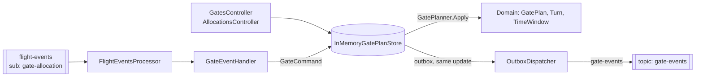

# svc-gate-allocation

> Plans which stand (gate) each departing aircraft uses and when, without double-booking a gate.

| | |
| --- | --- |
| Repo | `aeroflow-air/svc-gate-allocation` |
| Owner | AeroFlow platform (Tony Joanes) |
| Status | prototype, local only |
| Runs in | aeroflow-local AppHost resource `svc-gate-allocation`; Container Apps later (ADR-0007) |
| Last reviewed | 2026-10-13 |

Written to the [service docs standard](https://github.com/aeroflow-air/platform-handbook/blob/main/docs/standards/service-docs.md). The airport-wide picture is in the [airport overview](https://github.com/aeroflow-air/platform-handbook/blob/main/docs/architecture/airport-overview.md).

## Purpose

Owns the **gate plan**: the gates, their size and open/closed status, and every flight's allocation (an on-block to off-block window on one gate). It enforces the rules that make a plan valid: one allocation per flight, aircraft fits the gate, gate is open, a minimum turnaround between flights on a gate.

It does **not** own flights (svc-flight-status does) and does not plan arrivals yet. When a flight event changes an allocation, it publishes the result on `gate-events` so the ops dashboard (and later other consumers) can follow along.

## Design decisions

| Decision | Why | Link |
| --- | --- | --- |
| Pure domain (`GatePlanner.Apply(plan, command)` returns `Result<GatePlan>`), side effects at the edges | testable without I/O; typed errors with stable codes | [ADR-0004](https://github.com/aeroflow-air/platform-handbook/blob/main/docs/decisions/0004-functional-style-csharp.md) |
| Planner picks the smallest open free gate that fits, then lowest id | keeps big gates free for big aircraft | `Domain/GatePlanner.cs` |
| React to `flight-events` on its own subscription; never call other services | services stay decoupled; a new consumer just adds a subscription | [ADR-0013](https://github.com/aeroflow-air/platform-handbook/blob/main/docs/decisions/0013-central-event-bus.md) |
| Publish `gate-events` from a pure before/after diff of one flight's allocation | same event types whether the cause was Scheduled, Delayed or Departed; easy to test | `Domain/GateEvents.Diff`, platform-handbook#77 |
| Business rejections are completed, not retried | a retry would fail the same way; the log is the signal | `Messaging/FlightEventsProcessor.cs` |
| Messaging only starts when a `messaging` connection string exists | `dotnet run`, container and tests need no bus | `Program.cs` |
| Departures from the home airport only; every simulated turn is size C | the simulator sends no aircraft type, and arrivals are out of scope for now | `Messaging/GateEventHandler.cs` |
| OpenAPI via Swashbuckle, rendered by Scalar, Development only | [ADR-0015](https://github.com/aeroflow-air/platform-handbook/blob/main/docs/decisions/0015-api-documentation-openapi-scalar.md) | `Program.cs` |
| State in memory, seeded with a demo pier | no database until it is needed | `Storage/` |

## Architecture

- **Domain** (`src/AeroFlow.GateAllocation/Domain`): value types (`FlightNumber`, `GateId`, `TimeWindow`, `AircraftSize` C to F), `Gate`, `Turn`, `GatePlan`, the closed command set, and `GateEvent` / `GateEvents.Diff`.
- **Storage**: one in-memory plan updated atomically; seeded by `DemoGatePlan` with gates `7`, `9`, `21`, `R1` (C), `12` (D), `14` (E), `55A` (F). `R1` is closed, so six are usable. Minimum turnaround 15 minutes.
- **Messaging**: a hosted Service Bus processor (one message at a time, manual completion) hands each event to `GateEventHandler`, which turns it into a command. The plan change and the gate events it produced (`GateEvents.Diff`) are saved in **one atomic store update** (plan plus outbox); `OutboxDispatcher` then sends the outbox in order and removes each event once sent ([ADR-0017](https://github.com/aeroflow-air/platform-handbook/blob/main/docs/decisions/0017-reliable-event-publishing.md)).
- **API**: controllers over the same store. HTTP mutations do **not** publish gate events yet.

## Inputs

### HTTP API

| Method | Route | Purpose | Responses |
| --- | --- | --- | --- |
| GET | `/health` | liveness | 200 |
| GET | `/api/gates/ping` | probe | 200 |
| GET | `/api/gates` | all gates with their allocations | 200 |
| GET | `/api/gates/{gate}` | one gate | 200, 400, 404 |
| POST | `/api/gates/{gate}/close` | close a gate (`reason`) | 200, 400, 404, 409 |
| POST | `/api/gates/{gate}/reopen` | reopen it | 200, 400, 404, 409 |
| GET | `/api/allocations/{flightNumber}` | a flight's allocation | 200, 400, 404 |
| POST | `/api/allocations` | allocate (omit `gate` to let the planner pick) | 201, 400, 404, 409 |
| PUT | `/api/allocations/{flightNumber}/gate` | reassign | 200, 400, 404, 409 |
| PUT | `/api/allocations/{flightNumber}/window` | retime | 200, 400, 404, 409 |
| DELETE | `/api/allocations/{flightNumber}` | release | 204, 400, 404 |

Errors are `application/problem+json` with a `code` extension: 400 for validation (`invalid_flight_number`, `invalid_gate`, `invalid_aircraft_size`, `empty_time_window`), 404 (`gate_not_found`, `allocation_not_found`), 409 for rules (`gate_conflict`, `aircraft_too_large`, `gate_closed`, `gate_has_allocations`, `already_allocated`, `no_gate_available`, ...). Reference docs: `/scalar` and `/openapi/v1.json` when `ApiDocs:Enabled` is true (Development).

### Events consumed

| Topic | Subscription | Event types handled | Effect | Ignored |
| --- | --- | --- | --- | --- |
| `flight-events` | `gate-allocation` | `Scheduled` | `AllocateGate`, planner picks; window 45 min before `scheduledDeparture` to departure, size C; then `GateAssigned` | flights whose `origin` is not `HomeAirport` |
| | | `Delayed` | `RetimeTurn` to `scheduledDeparture + delayMinutes`; then `GateChanged` | |
| | | `Departed`, `Cancelled` | `ReleaseGate`; then `GateReleased` | |
| | | | | `Boarding`, `Landed` |

Contract: `Messaging/FlightEventMessage.cs`, a **local copy** of `AeroFlow.Local.FlightEvents.FlightEvent` in aeroflow-local. JSON web casing, enum as string.

### Configuration

| Setting | Default | Meaning |
| --- | --- | --- |
| `Outbox:RetrySeconds` | `5` | how often unsent gate events are retried when nothing else wakes the dispatcher |
| `ConnectionStrings:messaging` | unset | Service Bus; when unset the processor and publisher do not start |
| `FlightEvents:Topic` | `flight-events` | |
| `FlightEvents:Subscription` | `gate-allocation` | set by the AppHost via `FlightEvents__Subscription` |
| `FlightEvents:HomeAirport` | `LHR` | only departures from here are planned |
| `FlightEvents:GateMinutesBeforeDeparture` | 45 | on-block time before departure |
| `FlightEvents:DefaultAircraftSize` | `C` | size for simulated turns |
| `GateEvents:Topic` | `gate-events` | topic this service owns |
| `ApiDocs:Enabled` | false (true in Development) | Scalar and OpenAPI |

## Outputs

### Events published

Topic **`gate-events`** (owned by this service). JSON body is `Domain/GateEvent`; `Subject` = event type, `CorrelationId` = simulator flight id (always set), `MessageId` = event id. The event id is deterministic: a UUIDv5 of the triggering flight event's id and the gate event type, so a re-send has the same `MessageId` and consumers de-duplicate by `eventId`. Delivery is **at least once** (ADR-0017).

| Event | Caused by | Notable fields |
| --- | --- | --- |
| `GateAssigned` | `Scheduled` departure gets a gate | `flightNumber`, `flightId`, `gate`, `onBlock`, `offBlock`, `occurredAt` |
| `GateChanged` | `Delayed` retimes the turn, or a reassignment | as above; `previousGate` only when the gate moved |
| `GateReleased` | `Departed` or `Cancelled` | `flightNumber`, `flightId`, `gate`, `occurredAt` |

Rejected or ignored flight events publish nothing. Publishing only happens when `messaging` exists; otherwise a no-op publisher keeps everything in process. HTTP API changes are not published yet.

### Other side effects

Updates the in-memory gate plan. Logs `{Command} for {FlightNumber} after {EventType}` per applied event.

## Dependencies

| Dependency | Needed for | Behaviour when absent |
| --- | --- | --- |
| Service Bus (`messaging`), topic `flight-events`, subscription `gate-allocation` | following the simulator | API still works; no event processing |
| Service Bus topic `gate-events` | publishing for the ops dashboard | no-op publisher; plan still updates in memory |
| flight-simulator (aeroflow-local) | producing events | plan only changes through the API |
| Keycloak (`identity`) | referenced by the AppHost | not used; no auth yet |

## Failure modes

| Failure | How it shows up | Impact | What to do |
| --- | --- | --- | --- |
| All six open gates busy | warning `Scheduled for XX123 rejected: no_gate_available` | that flight gets no gate; message completed; no gate event | expected under load; lower `Simulator__NewFlightProbability` or add gates |
| Release or retime for a flight it never allocated | warning with `allocation_not_found` | none | expected after a restart |
| Redelivered flight event (any type, even after newer ones) | debug `ignored: event ... already applied` | none; the last 10,000 applied event ids are remembered with the plan | none |
| Unreadable or empty body | warning `Dead-lettered unreadable flight event`; message in the subscription's dead-letter queue | event lost to this service | contract copy has drifted from the simulator (#71); compare `FlightEventMessage` with `FlightEvent` |
| Flight event without `eventId` or `flightId` | warning `rejected: missing_event_identity` | flight ignored; no gate event | contract copy drifted (#71) |
| Invalid flight number | warning `invalid_flight_number` | flight ignored | simulator must send two-character airline + 1-4 digits |
| Bus unreachable | warning `Service Bus processor error`, repeating | no updates; the SDK retries | check the emulator in the Aspire dashboard |
| Publish to `gate-events` fails | warning `Publishing gate events failed; N pending in the outbox, retrying in 5s` | events wait in the outbox, in order, and are re-sent after each `Outbox:RetrySeconds` back-off (new changes don't shorten it) until the bus accepts them; the plan is unaffected | check the emulator; a growing pending count means the bus is still down |
| Send succeeded but reported failure (timeout) | same warning, then a second `Published ...` for that event | the event is sent twice with the same `MessageId`; duplicate detection on `gate-events` (turned on in the aeroflow-local AppHost, [aeroflow-local#11](https://github.com/aeroflow-air/aeroflow-local/pull/11); needs Standard tier in Azure) and consumer de-duplication by `eventId` drop the copy | none |
| Publish fails permanently (message too large, unauthorised, topic missing) | error `Permanent failure publishing gate events (Reason); N pending in the outbox are blocked behind it` | sending is strictly in order with no attempt limit, so this event and **everything behind it** stay queued and the in-memory outbox grows until it is fixed or the process restarts | fix the cause (usually the topic or permissions); poison handling and a size cap are tracked in [platform-handbook#108](https://github.com/aeroflow-air/platform-handbook/issues/108) |
| Shutdown or deploy | warning `Stopping with N gate events still in the outbox` only if some couldn't be sent | the dispatcher stops after the message processor and makes one last drain within the shutdown timeout, so a routine deploy normally loses nothing | if the warning appears, the bus was down at shutdown |
| Process restart | plan back to the demo seed | live allocations and any unsent outbox events lost; consumers see a fresh sequence after restart | expected; storage is in memory. A durable store must keep the outbox in the same transaction as the plan (ADR-0017). Edge case: a message applied but not completed before a crash is redelivered after the restart, and its `GateAssigned` gets the same id, possibly for a different gate, so duplicate detection or consumers may drop it. This goes away with durable state |

Inbound delivery is at least once. The handler is idempotent by event id: the store remembers applied flight event ids in the same atomic update as the plan and outbox, so a redelivery (including an old `Delayed` arriving after a newer one) changes nothing and queues nothing, and the original change's events are already in the outbox. Domain rules (`already_allocated`) are a second line of defence. One message is processed at a time.

## Running and testing

- Standalone: `dotnet run --project src/AeroFlow.GateAllocation`, then `curl http://localhost:8080/api/gates`; Scalar at `/scalar`.
- With the airport: clone next to `aeroflow-local` and run its AppHost. Healthy logs: `Listening for flight events on flight-events/gate-allocation`, then `AllocateGate for BA1234 after Scheduled` and a matching `GateAssigned` on `gate-events`.
- Tests: `dotnet test` covers the planner rules, value types, API (status codes and problem details), API docs, health, the event handler mapping, `GateEvents.Diff`, deterministic event ids and the outbox (failed publish, retry, ordering).
- Container: `docker build -t aeroflow-gate-allocation . && docker run --rm -p 8080:8080 aeroflow-gate-allocation`.

## Known gaps

- The outbox has no size limit and no poison handling (see failure modes; [platform-handbook#108](https://github.com/aeroflow-air/platform-handbook/issues/108)).
- HTTP API mutations do not publish gate events (only the flight-events path does).
- svc-flight-status still invents gate `TBA` at `Boarding`; it does not subscribe to `gate-events` yet.
- Arrivals are ignored; every simulated aircraft is size C.
- Event contracts are local copies ([platform-handbook#71](https://github.com/aeroflow-air/platform-handbook/issues/71)).
- `workload.yaml` cannot declare the `flight-events` / `gate-events` subscriptions ([platform-handbook#64](https://github.com/aeroflow-air/platform-handbook/issues/64)); this repo also has no workload CI yet.
- In-memory state; no authentication.
